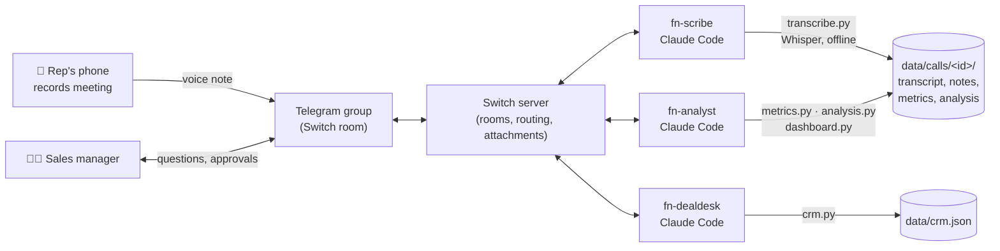

# FieldNotes

**An AI notetaker and sales coach for the conversations that happen offline, built on [Switch](https://github.com/sandbox-quantum/switch).**

Gong, Otter and Fireflies only hear what happens on Zoom. In India and in most of the world,
the deals that matter happen in person: store visits, a meeting at the client's office,
a demo on the shop floor. Nothing records those, so the manager never hears them, the CRM
is filled in from memory (if at all), and reps never get coached.

FieldNotes fixes that without asking anyone to install a new app. A rep records the meeting on
their phone and drops it into the team's Telegram group (or Slack/Discord). Three AI
teammates pick it up **in the same chat, in front of the team**:

```
Rep (Telegram, from the car park):  🎤 brightmart.ogg  "BrightMart, met Priya"

🎧 FieldNotes Scribe     Got it: transcribing offline now.
                         📝 Notes: Priya Shah (Head of Ops): 10 stores/week stock out,
                         ~₹4L/month lost. Wants real-time stock + reorder alerts...
                         [notes.md] [transcript_labeled.md]
                         @fn-analyst please analyse call 20261107-1702-brightmart

📊 FieldNotes Analyst    Deal score 68/100 🟢 · suggested stage: proposal
                         Rep talk ratio 53% · 11 questions · BANT: Need ✅ Timeline ✅
                         ⚠️ Price objection not handled: "I'm not sure the CFO will see it that way"
                         Coaching: anchor on ROI (₹4L/month recovered) before moving on
                         [scorecard.png]
                         @fn-dealdesk please update the CRM and draft the follow-up

🗂 FieldNotes Deal Desk  CRM: BrightMart → proposal, next step "CFO ROI session" Thu 12 Nov
                         ✉️ Draft to Priya: "BrightMart: 5-store pilot + Zoho comparison"...
                         Reply "approve" to send, "edit: ..." to revise.

Rep:                     approve
🗂 FieldNotes Deal Desk  ✅ Marked as sent and logged on BrightMart.

Sales manager:           @fn-analyst what objections keep coming up this month?
📊 FieldNotes Analyst    Price came up in 2 of 2 calls and was never handled...
                         [team-report.png]
```

## Why Switch is the backbone

FieldNotes is not a bot bolted onto a chat app. Without Switch it doesn't work:

| Switch feature | What FieldNotes uses it for |
|---|---|
| **Rooms bridged to Telegram/Slack/Discord** | The sales team's existing group *is* the product. Nobody installs anything. |
| **Attachments delivered to agents, already downloaded** | A voice note from a phone arrives at the scribe as a local file it can transcribe. |
| **`send_attachment`** | Notes, labelled transcripts, scorecards and team charts come back as real files in chat. |
| **Agents addressing agents** | Scribe → Analyst → Deal Desk hand-offs happen in the room, so the whole trail is visible. |
| **People in the loop** | The follow-up email is only "sent" after a human says *approve* in the room. |
| **Shared room history** | A manager can ask any agent about any past call; the context is already there. |
| **Agents run on your machine (Claude Code via Switch Console)** | Recordings never leave your laptop for transcription: Whisper runs locally. |
| **Templates** | One YAML file (`switch/fieldnotes.template.yaml`) creates all three agents and puts them in your room. |

## Architecture



- **`fn-scribe`** transcribes with [faster-whisper](https://github.com/SYSTRAN/faster-whisper) on CPU
  (≈1 min per 4 min of audio with the `small` model), labels speakers from context, writes notes.
- **`fn-analyst`** separates *measured* metrics (talk ratio, questions, longest monologue, from
  timestamps) from *judged* ones (deal score, BANT, objections, always quoted from the transcript)
  against a fixed schema, so calls can be compared across the team.
- **`fn-dealdesk`** keeps a CRM honest (a JSON file standing in for HubSpot/Salesforce) and drafts
  follow-ups with a human approval gate.

Each agent's behaviour lives in a plain-English playbook (`playbooks/*.md`) that a sales manager
can edit without touching code.

## Set it up (≈20 minutes)

**You need:** Windows/macOS/Linux, Node.js 20+, Python 3.10+, ffmpeg, a Claude Code login,
a Telegram account with a username.

### 1. Clone and install the tools
```bash
git clone <this repo> fieldnotes && cd fieldnotes
python -m venv .venv
.venv/Scripts/python -m pip install -r requirements.txt     # macOS/Linux: .venv/bin/python
```
Let the agents run the tools without asking every time:
`cp switch/claude-settings.example.json .claude/settings.json`

Optional check that everything works before Switch is involved:
```bash
pwsh demo/make_audio.ps1 demo/brightmart.txt      # makes demo/brightmart.ogg with Windows TTS
./py tools/transcribe.py demo/brightmart.ogg --title BrightMart
```

### 2. Install Switch Console and start a server
Download Switch Console from the [Switch releases](https://github.com/sandbox-quantum/switch/releases/latest),
open it and follow **Setting up Switch**: add a server on **This computer**, and confirm
**Claude Code** shows as installed under *Settings → Agent providers*.

### 3. Connect Telegram
1. In Telegram, talk to [@BotFather](https://t.me/BotFather): `/newbot`, save the token.
2. **Before adding the bot anywhere:** `/mybots` → your bot → *Bot Settings* → *Group Privacy* → **Turn off**.
3. Switch Console → your server → **Messaging apps** → **Connect** → Telegram → paste token and bot username.
4. Create a Telegram group (e.g. "Sales Floor"), add your bot. The group becomes a Switch room.

### 4. Create the three agents from the template
Switch Console → **Templates** → import `switch/fieldnotes.template.yaml`. Pick your Telegram
room as **Sales room** and this folder as **FieldNotes folder**. Console creates `fn-scribe`,
`fn-analyst` and `fn-dealdesk` and adds them to the room.

### 5. Make recordings go to the scribe automatically
In the Telegram group, type:
```
!assign-agent @fn-scribe
```
Now any voice note or audio file that mentions nobody goes to the scribe. (Or just caption the
recording with `@fn-scribe`.)

### 6. Try it
Send `demo/brightmart.ogg` (or record a real conversation) into the group with the caption
"BrightMart, met Priya". Then ask `@fn-analyst how is the team doing?`

## Tools

| Tool | Purpose |
|---|---|
| `tools/transcribe.py` | Offline Whisper transcription (ffmpeg decodes any phone format) |
| `tools/speakers.py` | Compact speaker labelling ("0:A,3:B,…") |
| `tools/metrics.py` | Measured conversation metrics + `scorecard.png` |
| `tools/analysis.py` | Schema, validation and chat-ready scorecard for `analysis.json` |
| `tools/crm.py` | File-backed CRM: pipeline, accounts, history, follow-up status |
| `tools/dashboard.py` | Cross-call team report + chart |
| `demo/make_audio.ps1` | Turns a role-play script into a test recording with Windows TTS |

Set `FIELDNOTES_WHISPER_MODEL` to `base` for speed or `medium`/`large-v3` for accuracy and
Hinglish-heavy conversations.

## Privacy

Recordings are transcribed on the machine running the agents; no audio goes to a transcription
API. `data/` is git-ignored. Analysis is done by the Claude Code agent you already use, so
transcript text goes through your existing Claude Code account. Always tell people when you
record a conversation and get their consent.

## Limits and what's next

- Speaker labels come from the LLM reading the transcript, not acoustic diarization: reliable for
  2-3 people, weaker for group meetings. pyannote diarization is a drop-in upgrade in `transcribe.py`.
- The CRM is a JSON file; `tools/crm.py` is the single seam to swap for HubSpot/Salesforce.
- Switch has no scheduler: a weekly digest needs an external trigger posting `@fn-analyst weekly report`.

Built for the WeMakeDevs × DevTools Academy × Switch **Flip the Switch** hackathon.
