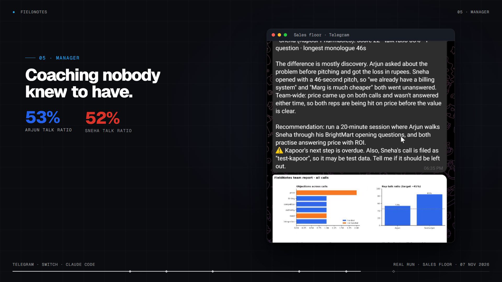
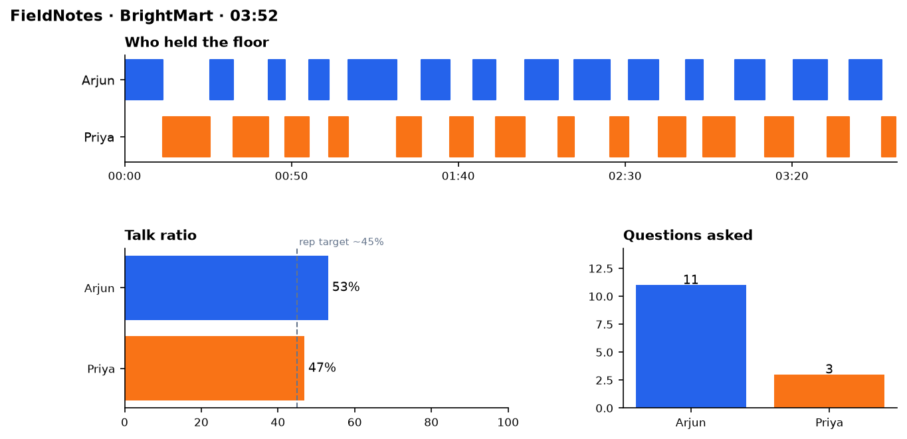
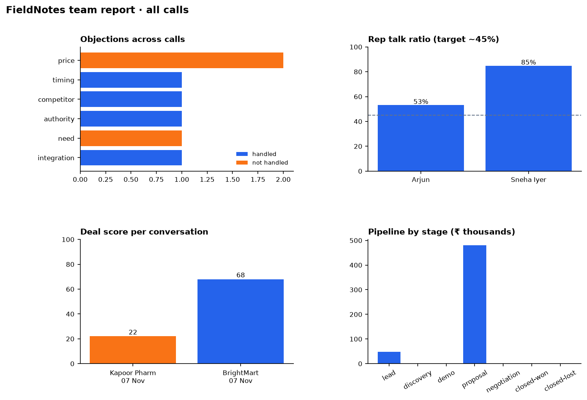
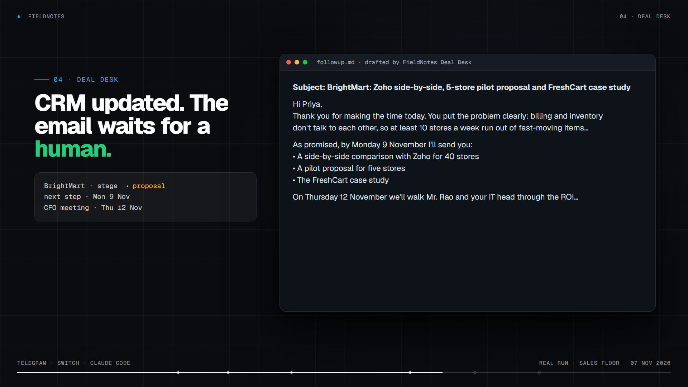
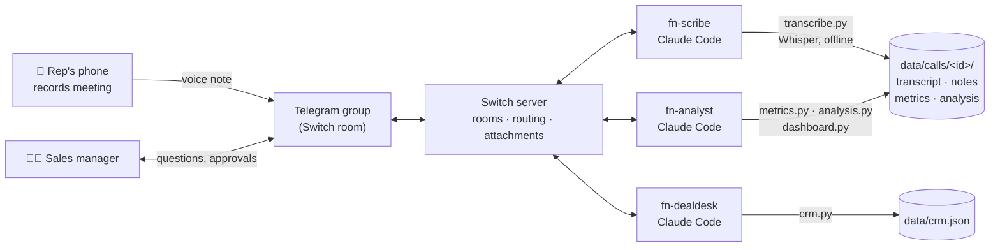

<div align="center">

# FieldNotes

**An AI notetaker and sales coach for the conversations that happen offline.**

Reps record in-person meetings on their phone and drop them into the team's Telegram group.
Three AI agents transcribe, analyse, update the CRM and draft the follow-up, right there in the chat.


### ▶ [Watch the 2-minute demo](https://youtu.be/x07z0l2V8cU) · 📝 [Read the build story](https://builder.aws.com/content/3LmUm1UZ5lqjvz6clAMOJCEVGbK/i-built-an-ai-sales-coach-that-lives-in-a-telegram-group)

<a href="https://youtu.be/x07z0l2V8cU"></a>

</div>

---

## Why

Call recorders like Gong, Otter and Fireflies only hear what happens on Zoom. But in retail, FMCG,
pharma, real estate and B2B distribution, the deals that matter happen **in person**: a store visit,
a meeting at the client's office, a demo on the shop floor. Nothing records those, so:

- the CRM is filled in from memory, if at all;
- managers never hear what customers actually said;
- reps never get coached on the conversations that decide their quarter.

FieldNotes fixes that **without asking anyone to install an app**. The team's existing chat group is
the whole interface.

## How it works

```text
Rep (from the car park):   🎤 brightmart.ogg   "BrightMart, met Priya"

FieldNotes Scribe          Got it: transcribing offline now.
                           📝 Notes: Priya (BrightMart): 10 stores/week stock out, ~₹4L/month lost.
                              Wants real-time stock + reorder alerts. Next: pilot proposal by Mon 9 Nov.
                           [notes.md] [transcript_labeled.md]
                           @fn-analyst please analyse call 20261107-1850-brightmart

FieldNotes Analyst         📊 Deal score 68/100 · suggested stage: proposal
                           Rep talk ratio 53% · 11 questions · BANT: Need ✅ Timeline ✅
                           ⚠️ Price objection not handled: "I'm not sure the CFO will see it that way."
                           Coaching: anchor on ROI (₹4L/month recovered) before moving on.
                           [scorecard.png]
                           @fn-dealdesk please update the CRM and draft the follow-up

FieldNotes Deal Desk       🗂 CRM: BrightMart → proposal · next step Mon 9 Nov · CFO meeting Thu 12 Nov
                           ✉️ Draft to Priya: "BrightMart: Zoho side-by-side, 5-store pilot proposal…"
                           Reply "approve" to send, "edit: …" to revise.

Rep:                       approve
FieldNotes Deal Desk       ✅ Marked as sent and logged on BrightMart.

Sales manager:             @fn-analyst how is the team doing? compare Arjun and Sneha
FieldNotes Analyst         Sneha talked 85% of the time and asked one question; Arjun 53% and 11.
                           Price came up on both calls and was never answered… [team-report.png]
```

The example above is a real run, from a role-played meeting in [`demo/`](demo/).

## Screenshots

| The analyst answering a manager in Telegram | Call scorecard (measured from timestamps) |
|---|---|
|  |  |

| Team report across every call | Follow-up drafted for human approval |
|---|---|
|  |  |

## Features

- **Offline transcription.** [faster-whisper](https://github.com/SYSTRAN/faster-whisper) runs on the
  machine that runs the agents. No audio is sent to a transcription API.
- **Any phone format.** Telegram voice notes (ogg/opus), iPhone m4a, mp3 and wav are decoded with ffmpeg.
- **Speaker labelling** from context, stored compactly as the segments where the speaker changes.
- **Measured conversation metrics:** talk ratio, questions asked, longest monologue, words per minute,
  filler words and speaker switches, all computed from timestamps.
- **Judged deal analysis against a fixed schema:** deal score, BANT, objections (handled or not),
  buying signals, risks, competitors, next steps and coaching. Every judgement quotes the transcript.
- **CRM updates and follow-up drafts**, with relative dates ("next Thursday") turned into real dates.
- **A human approval gate.** Nothing is marked as sent until a person replies `approve` in the chat.
- **Team analytics.** Managers ask questions in plain language and get an answer plus a chart.
- **Editable behaviour.** Each agent follows a plain-English playbook in [`playbooks/`](playbooks/)
  that a sales manager can change without touching code.

## Architecture



| Agent | Job | Playbook |
|---|---|---|
| `fn-scribe` | Transcribes the recording, labels speakers, writes meeting notes, hands off to the analyst | [`playbooks/scribe.md`](playbooks/scribe.md) |
| `fn-analyst` | Measures and scores the call, coaches the rep, answers team-wide questions | [`playbooks/analyst.md`](playbooks/analyst.md) |
| `fn-dealdesk` | Updates the CRM, drafts the follow-up, waits for a human to approve | [`playbooks/dealdesk.md`](playbooks/dealdesk.md) |

### Built on Switch

[Switch](https://github.com/sandbox-quantum/switch) connects AI agents to team chat. FieldNotes depends on it for:

| Switch feature | What FieldNotes uses it for |
|---|---|
| Rooms bridged to Telegram, Slack, Discord, Teams, Mattermost | The sales team's existing group is the product. Nobody installs anything. |
| Attachments delivered to agents, already downloaded | A voice note from a phone reaches the scribe as a local file. |
| `send_attachment` | Notes, transcripts, scorecards and charts come back as real files in chat. |
| Agents addressing agents | Scribe → Analyst → Deal Desk hand-offs happen in the room, visible to everyone. |
| People in the loop | Follow-ups are approved or edited by a person, in the room. |
| Templates | [`switch/fieldnotes.template.yaml`](switch/fieldnotes.template.yaml) creates all three agents and puts them in your room. |

## Quick start

**Requirements:** Python 3.10+, ffmpeg, Node.js 22+, a Claude Code login, and a Telegram account
with a username (or a Slack, Discord or Mattermost workspace).

### 1. Install

```bash
git clone https://github.com/Dupahar/FieldNotes.git
cd FieldNotes
python -m venv .venv
.venv/bin/pip install -r requirements.txt          # Windows: .venv\Scripts\pip install -r requirements.txt
cp switch/claude-settings.example.json .claude/settings.json   # let the agents run the tools without prompts
```

Check the pipeline works before connecting chat:

```bash
./py tools/transcribe.py demo/brightmart.ogg --title BrightMart
```

### 2. Run Switch and connect Telegram

1. Install **Switch Console** from the [Switch releases](https://github.com/sandbox-quantum/switch/releases/latest)
   and add a server on **This computer**.
2. Create a bot with [@BotFather](https://t.me/BotFather) (`/newbot`), then turn **Group Privacy off**
   (`/mybots` → Bot Settings → Group Privacy).
3. In Switch Console: **Messaging apps → Connect → Telegram**, and paste the token and bot username.
4. Create a Telegram group, add the bot, **make it an administrator**, and send any message.
   The group becomes a Switch room.

### 3. Create the agents

Switch Console → **Templates** → import [`switch/fieldnotes.template.yaml`](switch/fieldnotes.template.yaml).
Pick your room, the path to this folder, and the machine to run on. Then in the group:

```text
!assign-agent @fn-scribe      # every recording goes to the scribe without tagging it
!list-agents                  # should list fn-scribe, fn-analyst, fn-dealdesk
```

### 4. Use it

Send a recording to the group with a caption such as *"BrightMart, met Priya"*. Then try:

```text
@fn-analyst how is the team doing this week?
@fn-analyst why did BrightMart score 68?
@fn-dealdesk what's overdue?
@fn-scribe what did Priya say about Tally?
```

## Configuration

| Setting | Default | Notes |
|---|---|---|
| `FIELDNOTES_WHISPER_MODEL` | `small` | `base` for speed; `medium` / `large-v3` for accuracy and Hinglish-heavy audio |
| Agent behaviour | `playbooks/*.md` | Plain English. Edit and tell the agent its playbook changed. |
| Shared rules | `CLAUDE.md` | Data layout and rules every agent follows |
| CRM | `data/crm.json` | `tools/crm.py` is the single seam to swap for HubSpot or Salesforce |

## Project structure

```text
FieldNotes/
├── CLAUDE.md                     shared instructions for all three agents
├── playbooks/                    one plain-English playbook per agent
├── switch/
│   ├── fieldnotes.template.yaml  creates the three agents in your room
│   └── claude-settings.example.json
├── tools/
│   ├── transcribe.py             offline Whisper transcription
│   ├── speakers.py               speaker labelling
│   ├── metrics.py                measured metrics + scorecard.png
│   ├── analysis.py               analysis schema, validation, chat scorecard
│   ├── crm.py                    file-backed CRM
│   └── dashboard.py              team report + chart
├── demo/                         role-play scripts, sample recordings, TTS generator
├── py                            runs the project's venv Python on any OS
└── data/                         recordings, transcripts, CRM (git-ignored)
```

Run any tool with `--help` for its options.

## Privacy

- Recordings are transcribed locally; audio never goes to a transcription service.
- `data/` (recordings, transcripts, CRM) is git-ignored.
- Transcript text is analysed by the Claude Code agents under your own account.
- Agents never paste full transcripts into chat; they attach them as files.
- Always tell people when a conversation is recorded and get their consent.

## Troubleshooting

| Symptom | Fix |
|---|---|
| Recordings are ignored unless you @-mention an agent | Make the bot a group admin, or turn Group Privacy off and re-add the bot. |
| Agents land in a room with a dead chat id | Promoting the bot can upgrade the group to a supergroup with a new id. Use `/invite_agent @fn-scribe` (and the other two) in the group. |
| "Not supported here" for every provider on Windows | Run the agents on a managed machine (the template's `machine` field), not a local session. |
| Remote host: "SSH agent socket not found" on Windows | Use a full path for `IdentityFile` in `~/.ssh/config`; `~` isn't expanded there. |
| Remote host says Node is too old | The agent controller needs Node 22.13+. |
| `ffmpeg could not decode` | Install ffmpeg and make sure it's on `PATH`. |

## Roadmap

- Acoustic speaker diarization (pyannote) for group meetings
- HubSpot / Salesforce / Zoho CRM connectors
- A weekly coaching digest posted to the group on a schedule
- Hindi and Hinglish tuned transcription
- Per-room retention policy for recordings

## Contributing

Issues and pull requests are welcome. Agent behaviour lives in `playbooks/` and the deterministic
parts in `tools/`, so most improvements are a playbook edit or a small, self-contained script.
